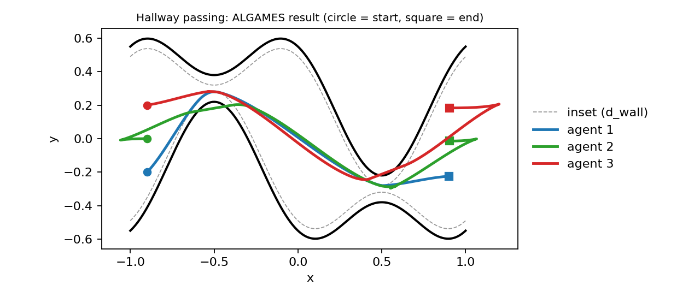

# Hallway Passing

Three unicycle agents start dispersed on the left of a corridor and must reach goals on the right. The corridor has two chokes whose centre-lines are offset in opposite directions (an S-shape), and each choke is narrower than the safe distance, so the agents have to pass in single file, swinging up through the first choke and down through the second. This is the *narrowing hallways* problem of the FALCON paper ([OutlandArya](@cite)).

!!! note "Status"
    The definition, the reference plan and the metrics are tested (`test/falcon_cases_test.jl` in `DifferentialGamesBenchmarks.jl`). The result reported below is from a run of `ALGAMES` against the current sources; it is **not** executed by the documentation build (it takes several minutes). No solver in the ecosystem is shown to converge on this game; see [What to expect](#What-to-expect).

## The game

```julia
using DifferentialGamesBenchmarks, DifferentialGamesBase

params = HallwayParameters()          # N = 100 steps of 0.1 s, d_safe = 0.17, ...
game_  = hallway_game(params)         # a three-player PD-GNEP
case   = HALLWAY_PASSING_NOMINAL_V1   # CaseID(:HallwayPassing, :Nominal, v"1")
```

### Geometry

The corridor is smooth, so every solver that differentiates the constraints sees well-defined gradients. For ``x\in[-1,1]``:

```math
y_c(x)=-y_{\text{bump}}\sin(\pi x),\qquad
w(x)=w_{\text{narrow}}+(w_{\text{wide}}-w_{\text{narrow}})\cos^2(\pi x),
```

the centre-line and half-width. The chokes are at ``x=\pm\tfrac12``, where ``w=w_{\text{narrow}}`` and the centre-line is at ``\pm y_{\text{bump}}``; the corridor is open at ``x=0,\pm1``. The functions are `hallway_centerline(params, x)` and `hallway_halfwidth(params, x)`.

| Parameter | Default | Meaning |
|-----------|---------|---------|
| `N`, `dt` | 100, 0.1 | steps and step size (10 s horizon) |
| `y_bump` | 0.3 | centre-line offset at each choke |
| `w_wide`, `w_narrow` | 0.55, 0.08 | half-width in the open sections and at the chokes |
| `d_safe` | 0.17 | hard inter-agent distance; **must satisfy** `2·w_narrow < d_safe` (single file) |
| `d_wall` | 0.06 | safety inset from the wall |
| `dy` | 0.2 | vertical spread of the starts and goals |
| `v_max`, `ω_max` | 1, π/3 | control bounds |
| `ρ_goal`, `ρ_ctrl` | 1000, 1 | terminal goal weight and control-effort weight |
| `d_comm` | `Inf` | communication range; a finite value adds the hard range constraint of the paper |

The constructor asserts the single-file condition, so a parameter set that lets two agents pass abreast is rejected.

### Model

Each agent is a unicycle ``\dot x=v\cos\theta,\ \dot y=v\sin\theta,\ \dot\theta=\omega`` with controls ``(v,\omega)\in[0,v_{\max}]\times[-\omega_{\max},\omega_{\max}]``. Agent ``i`` starts at ``(-0.9,\ (i-2)\,d_y,\ 0)`` and has the goal ``(0.9,\ (i-2)\,d_y,\ 0)``.

```math
J_i=\rho_{\text{goal}}\,\|x_i(T)-g_i\|^2+\rho_c\sum_k\big(v_{ik}^2+\omega_{ik}^2\big),\qquad \rho_c=1 .
```

| Constraint | Form |
|------------|------|
| Control bounds | `ControlBounds` per agent |
| Walls | `PrivateInequality` per agent: ``\lvert p_y-y_c(p_x)\rvert\le w(p_x)-d_{\text{wall}}`` |
| Collision | one `SharedInequality` with three pairwise rows: ``d_{\text{safe}}^2-\|p_i-p_j\|^2\le0`` |
| Communication (optional) | pairwise ``\|p_i-p_j\|^2-d_{\text{comm}}^2\le0`` |

### Differences from the paper and the FALCON script

| FALCON | This benchmark |
|--------|----------------|
| Euler map ``x_{k+1}=x_k+\Delta t\,f(x_k,u_k)`` | continuous unicycle; every solver integrates it itself |
| hard terminal ball ``\|p_N-g\|\le\varepsilon`` (script) | the paper's quadratic terminal cost ``\rho_{\text{goal}}\|x_N-g\|^2`` |
| proximity repulsion ``\rho_p\max(0,d_p-\|p_i-p_j\|)^2`` (paper) | not included: the hard collision constraint carries the separation |
| soft communication cost and hard range constraint | the hard range constraint only, off by default |
| wall inset ``d_{\text{wall}}+d_{\text{buffer}}=0.04+0.02`` | a single inset `d_wall = 0.06` |

The cost and constraint functions pick out the player's own block when they are handed the joint vector, so they give the same value whichever convention a solver uses (see [Conventions](../ecosystem/conventions.md)).

## Solving it

```julia
using DifferentialGamesBaseSolvers

ws  = hallway_warmstart(params)
sol = DifferentialGamesBase.solve(game_, ALGAMES(; outer_iter = 30, inner_iter = 15); warmstart = ws)
res = evaluate(hallway_passing_evaluator(; params), game_, sol)

res.quality[:goal_error]       # largest final distance from a goal
res.quality[:min_separation]   # smallest pairwise distance (limit: d_safe = 0.17)
res.quality[:wall_clearance]   # smallest signed distance to a wall after the inset (negative = violated)
```

A straight-line initialization drives the agents through the walls, so a warm start is needed. `hallway_warmstart` builds the controls of a plan in which the three agents follow the corridor centre-line through both chokes, blending from their start heights before the first choke and to their goal heights after the second, with agent `order[k]` starting `(k-1)·gap` seconds after the first (default order 2, 3, 1 and gap 1.5 s). The unicycle is differentially flat, so the controls follow from the arc length and heading of the reference path, and the speed is lowered where the path curves so that the turn rate stays below 85 % of its bound.

The plan is good but not feasible, which the tests state: rolled out open loop with the exact unicycle step, every agent stays within 5 mm of the inset wall, reaches its goal within 5 cm, and the agents never come closer than 0.05 (their minimum separation is about 0.07, below the 0.17 limit where paths cross). The solver has to repair that.

**Result with `ALGAMES`** (`outer_iter = 30`, `inner_iter = 15`, the plan above as warm start, on the machine used for this documentation):

| Quantity | Value |
|----------|-------|
| wall time | 333 s |
| `sol.converged` | `false` |
| `:goal_error` | 0.025 |
| `:min_separation` | 0.1697 (limit 0.17) |
| `:wall_clearance` | −0.0017 (a 1.7 mm violation of the inset wall) |
| `validity[:constraints_satisfied]` | `false` |
| solver's optimality residual | 5.6·10³ |

The three agents traverse both chokes in single file and end near their goals, with the constraints violated by millimetres, so the result is *nearly feasible*. It is not an equilibrium: the optimality residual is large, and the figure shows agents 2 and 3 overshooting their goals and doubling back, which a Nash solution of this cost would not do. Without the warm start the solver ends with a 0.107 separation and 3 cm of wall violation after 206 s (run with `N = 60`, `dt = 0.15`).


## What to expect

This is a hard problem for a general-purpose augmented-Lagrangian solver: the constraints are active at the chokes, the problem is non-convex, and the agents must coordinate an ordering that the cost does not specify. The `ALGAMES` result above is the best obtained with the solvers in this ecosystem, and it needs the warm start. FALCON, the solver this benchmark comes from, is designed for exactly this structure (partially decoupled dynamics with coupled constraints), is external and was not run here.

## Visualization

With `CairoMakie` or `GLMakie` loaded, `gameplot(HALLWAY_PASSING_NOMINAL_V1, sol)` draws the three paths and the two walls (a visualizer is registered for the case).



*Paths returned by the run above. The walls are drawn for ``x\in[-1,1]``; the dashed lines are the inset walls the constraints use.*
