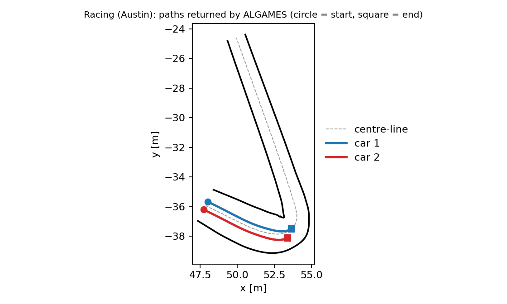

# Racing (Austin)

Two cars race head to head on a 20 m segment of the Circuit of the Americas at tenth scale. The problem is the two-car racing benchmark of Zhu and Borrelli ([ZhuBorrelli2024](@cite)), used in the FALCON paper ([OutlandArya](@cite)) to compare against their DGSQP solver. It is a small game with hard numerics: stiff nonlinear tyre dynamics, a progress state decoupled from the position, a competitive terminal cost and track-boundary constraints.

!!! note "Status"
    The definition, reference plan and metrics are tested (`test/falcon_cases_test.jl` in `DifferentialGamesBenchmarks.jl`). On the nominal game below `ALGAMES` returns without convergence and without improving on its starting plan; `FALCON` and `DGSQP` with tuned parameters solve the hairpin version (see [Solving the hairpin with FALCON and DGSQP](#Solving-the-hairpin-with-FALCON-and-DGSQP)). The examples on this page were run against the current sources but are not executed by the documentation build.

## The game

```julia
using DifferentialGamesBenchmarks, DifferentialGamesBase

track = austin_track()                       # RaceTrack: C² centre-line, left/right half-widths, 19.985 m
params = RacingParameters()                  # tenth-scale car, N = 50 steps of 0.05 s
game_ = racing_game(track, params)           # a two-player PD-GNEP

case = RACING_AUSTIN_NOMINAL_V1              # CaseID(:Racing, :AustinNominal, v"1"); game(case) rebuilds it
```

### Model

Each car has the 7-state dynamic bicycle model with Pacejka lateral tyre forces and all-wheel drive, extended with a progress state ``s`` that advances at a controlled rate:

```math
q=[v_x,\ v_y,\ \dot\psi,\ x,\ y,\ \psi,\ s],\qquad u=[a,\ \gamma,\ u_s],\qquad \dot s=u_s ,
```

with acceleration ``a``, steering angle ``\gamma`` and progress rate ``u_s``. The lateral forces are ``F_y = D\sin\!\big(C\arctan(B\alpha)\big)``, ``B=10``, ``C=2.5``, with the slip angles ``\alpha_f,\alpha_r`` of the front and rear axle. Parameters (`RacingParameters`): wheel base ``l_f=l_r=0.18`` m, mass 70 kg, ``I_z=2.0627``, friction ``\mu=0.9``; bounds ``a\in[-2.1,2.1]``, ``|\gamma|\le0.436``, ``u_s\in[0,4]``.

!!! tip "Why the step is 0.05 s"
    The tyre model is stiff. Integrated with one RK4 step per 0.1 s the same control sequence gives a *different trajectory* (in the test case the two cars ended 0.055 m apart instead of 0.6 m). The solvers here take one RK4 step per `dt`, so the benchmark uses `dt = 0.05` (50 steps over the same 2.5 s). The FALCON script instead wraps an RK4 map with ten substeps inside each 0.1 s step; the Base solvers have no such map-style dynamics, so the horizon is refined instead.

### Track

`RaceTrack` is a natural cubic spline through 41 waypoints (`data/f1_austin_segment.csv`, the arc-length range 60–80 m of the tenth-scale track, re-based to 0), with spline half-widths to each side (0.63 m to 1.40 m on this segment). The unit tangent, the contouring error ``e_c``, the lag error ``e_l`` and the signed lateral offset ``e_y`` of a point relative to the centre-line point at arc length ``s`` are `track_tangent`, `track_errors`.

### Objective and constraints

Each car ``i`` minimizes

```math
J_i=\sum_k \tfrac12\,u_k^\top W u_k+\tfrac12\big(q_c\,e_c^2+q_l\,e_l^2\big)\;-\;w_p\,s_i(T)\;+\;w_c\big(s_j(T)-s_i(T)\big),
```

the contouring/lag cost ties ``s`` to the car's position (the progress integrator alone is decoupled from ``(x,y)``), the progress reward drives the car forward and the last term makes the race competitive: a car is paid for the margin by which it is ahead. Constants: ``W=\mathrm{diag}(1,1,10^{-4})``, ``q_c=0.1``, ``q_l=20``, ``w_p=1``, ``w_c=5``.

| Constraint | Form |
|------------|------|
| Control bounds | `ControlBounds` per car |
| Track boundary | `PrivateInequality` per car: ``e_y-\text{left}(s)\le 0`` and ``-e_y-\text{right}(s)\le 0`` |
| Collision | one `SharedInequality`: ``d_{\min}^2-\|p_1-p_2\|^2\le0`` with ``d_{\min}=2\sqrt{(L/2)^2+(W/2)^2}\approx0.595`` m, the diameter of the bounding circle of a 0.56 m × 0.2 m car |

The cars start side by side at ``s=0`` with lateral offsets ``\pm0.3`` m and speed 2 m/s (`racing_starts`).

### Differences from the FALCON script

| FALCON script | This benchmark |
|---------------|----------------|
| `Interpolations.jl` cubic spline, pre-sampled tangent | own natural cubic spline (no dependency), analytic tangent |
| RK4 map, 10 substeps of 0.1 s | continuous ODE; the solver takes one RK4 step per `dt = 0.05` |
| input-*rate* penalty ``\tfrac12 w_{\Delta}(u-u_{\text{prev}})^2`` and rate bounds | omitted (they need the previous control, which only some solvers expose) |
| opponent progress read from the solver's workspace | read from the joint terminal state; a solver that passes only a player's own block pays the own-progress cost only |
| single-agent FALCON warm start | closed-loop centre-line plan `racing_warmstart` |

## Solving it

```julia
using DifferentialGamesBaseSolvers

ws  = racing_warmstart(track, params)        # controls of a closed-loop centre-line plan
sol = DifferentialGamesBase.solve(game_, ALGAMES(; outer_iter = 20, inner_iter = 15); warmstart = ws)
res = evaluate(racing_evaluator(; track), game_, sol)

res.quality[:progress]          # final arc length of each car, in metres
res.quality[:min_separation]    # closest approach (must be ≥ 0.595)
res.quality[:track_clearance]   # distance of the centre to the nearest edge (negative = off track)
res.quality[:lag]               # distance between a car and the centre-line point at its own s
```

`racing_warmstart` simulates each car with its own dynamics under curvature feed-forward plus lateral and heading feedback, holding the car's initial lateral offset and driving at 2.5 m/s, and returns the controls it applied; the progress rate is set to the forward speed so ``s`` stays tied to the position. It is the reference plan the tests check: it stays on the track, keeps the cars apart and progresses over 5 m.

**Result with `ALGAMES`** (20 outer iterations of up to 15 inner iterations, run on the machine used for this documentation):

| Quantity | Value |
|----------|-------|
| wall time | 37 s |
| `sol.converged` | `false` |
| final progress, car 1 / car 2 | 5.987 m / 5.989 m |
| minimum separation | 0.597 m (limit 0.595 m) |
| track clearance | 0.72 m (feasible) |
| lag | 0.45 m |
| solver's optimality residual after 20 outer iterations | 2.8·10⁴ (not decreasing) |

The solver does not take a step: in every outer iteration the line search of the first inner iteration returns step size zero and the returned trajectory is the warm-start rollout, which is feasible by construction (so the constraint check passes) but is a path, not an equilibrium. Larger regularization (`reg = 1`, `reg = 100`) and a larger penalty (`ρ_init = 100`) give the same trajectory, and with no warm start the cars do not move (progress 0). The default `:nash_residual` metric reports 0 for this trajectory; it checks cost bookkeeping only (see the [warning](overview.md#Scoring-a-solution)).

!!! warning "Reading the result"
    Do not read the progress above as a race outcome. Both cars follow the same plan, so there is no winner, and nothing here is a solution of the game. The nominal game with `dt = 0.05` was not run with `FALCON` or `DGSQP`; their tuned results below are for the hairpin game of the FALCON paper.

## The hairpin and the 50 initial conditions

`austin_hairpin_track()` is the 30 m segment `s ∈ [60, 90]` m that contains the first hairpin (the sharp-corner example of the FALCON figure) and the case `Racing.AustinHairpin_v1` the same game on it with a 4 s horizon. `austin_benchmark_initial_conditions()` returns the 50 random initial conditions of the FALCON paper's comparison against DG-SQP on the 20 m segment (7 states per car, `q0_1`, `q0_2`), together with the results of the original Python DG-SQP on them, and `racing_game_from_ic(i)` builds the game started from the `i`-th one. The FALCON benchmark uses ten RK4 substeps per 0.1 s; the cases here take one RK4 step per `dt = 0.05` (a 2.5 s horizon is `N = 50`)..

## Solving the hairpin with FALCON and DGSQP

The sharp-corner comparison of the FALCON paper uses the exact FALCON game: dynamic bicycle with ten RK4 substeps per 0.1 s, `N = 25`, the segment `s ∈ [60, 80]` m, contouring/lag weight ``q_l=20``, hard track boundaries and a collision constraint. The game is built by `src/solvers/DGSQP/examples/austin_hairpin.jl` (`austin_hairpin_game`) in `DifferentialGamesBaseSolvers.jl`, and by the script `examples/f1_austin_benchmark.jl` in the FALCON repository. Both solvers start from the same single-agent warm starts and stop at the same tolerances: feasibility ``\le10^{-4}`` and optimality ``\le2\cdot10^{-2}``.

Both solvers converge on all 50 initial conditions with the parameters below. The parameters were tuned on these 50 initial conditions, so another problem may need its own.

### FALCON

```julia
using DifferentialGamesBase, DifferentialGamesBaseSolvers, FALCON

solver = falcon(;
    r0 = 0.5, r_max = 1.0, r_min = 1e-5, α_2 = 1.5, η = 100.0,         # trust region, proximal weight
    w0 = 10.0, β = 2.0, γ_δ = 0.9, ω_max = 1e4,                         # augmented Lagrangian
    ϵ_opt = 2e-2, ϵ_feas = 1e-4, max_iterations = 400,                  # convergence
    socp_tol_loose = 1e-5, socp_tol_tight = 1e-5, socp_tol_switch = 1e-2,
    infeasibility_preprocessing = true, preprocess_iters = 5,
    ζ_cert_abs_tol = 2e-3, ζ_cert_rel_tol = 1e-2, ζ_cert_polish_ΔJ_tol = 1.0)

sol = solve(game, solver; warmstart = ws)      # game, ws: the hairpin PDGNEProblem and its single-agent warm start
```

What differs from the defaults and why: `ω_max = 1e4` (the default cap `1e3` stops a few initial conditions short of feasibility), `r_min = 1e-5` (lets the trust region recover once the penalty is large), and the relaxed ζ-certificate tolerances (the defaults reject most convexified solves on this game). See [FALCON](../solvers/falcon.md#Tuning).

### DGSQP

```julia
using DifferentialGamesBase, DifferentialGamesBaseSolvers

solver = dgsqp_tuned_options()                 # DGSQP(; ...) with the settings below
res    = dgsqp_solve(game_ol, w0; solver)      # game_ol: the OpenLoopGame of the hairpin, w0 the warm start
```

`dgsqp_tuned_options()` is the racing-paper variant of DGSQP (non-monotone step acceptance with decaying regularization) with `reg = 1e3`, `reg_decay = 0.9`, `delta_decay = 0.95`, `merit_decrease = 0.01`, `nms_frequency = 10`, `nms_memory_size = 10`, `sqp_iters = 500`, `p_tol = 1e-4`, `d_tol = 2e-2`, plus two extensions of the reference code (an elastic QP when a QP is infeasible, and recovery from the last checkpoint after a divergence). The reference settings converge on 33 of the 50 initial conditions; the sweeps behind the tuned settings and the timings are on the [DGSQP page](../solvers/dgsqp.md#Reproducing-the-FALCON-paper's-DG-SQP-comparison).

## Visualization

With `CairoMakie` or `GLMakie` loaded, `gameplot(RACING_AUSTIN_NOMINAL_V1, sol)` draws both cars' paths and the track edges (a visualizer is registered for the case).



*Both cars' paths on the Austin segment (left and right edges and centre-line); the cars start side by side and follow the reference plan. Figure produced from the run above.*
