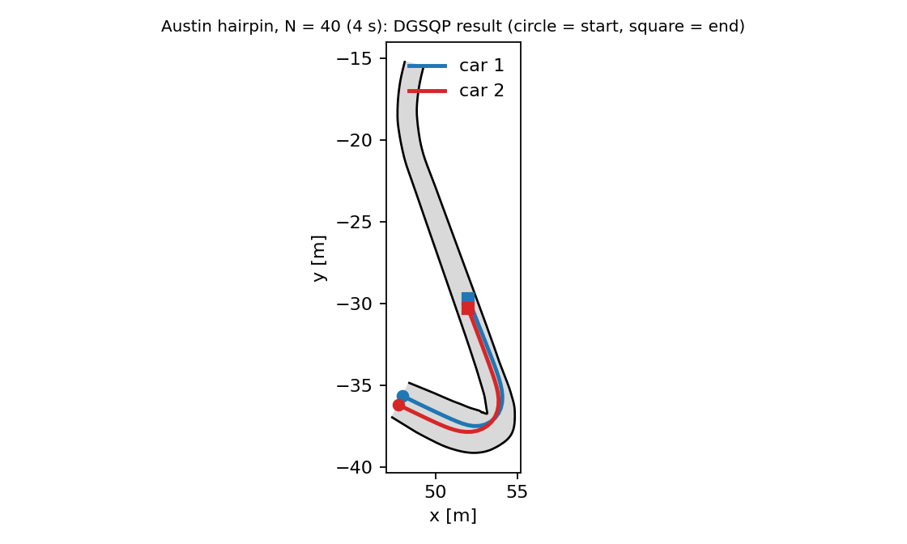

# DGSQP

**Dynamic Game Sequential Quadratic Programming** ([ZhuBorrelli2023](@cite)). Computes a local open-loop generalized Nash equilibrium of a discrete-time game with nonlinear dynamics and constraints by solving *one* convex quadratic program per iteration. This is a Julia implementation of the algorithm of the paper and of its reference code (<https://github.com/zhu-edward/DGSQP>, MIT licence).

!!! note "Status"
    Implemented in `DifferentialGamesBaseSolvers.jl` (`src/solvers/DGSQP`), with a test suite and a replication of the paper's curved-track study. The examples on this page were run against the current sources but are not executed by the documentation build.

## Algorithm

With the shared multiplier ``\lambda\ge0`` (a normalized equilibrium), a local equilibrium of the open-loop game satisfies the KKT system

```math
\nabla_{u^i}\mathcal L^i(u,\lambda)=0\ \ \forall i,\qquad C(u)\le0,\qquad \lambda^\top C(u)=0,\qquad \lambda\ge0 ,
```

where ``\mathcal L^i=J^i+C^\top\lambda`` and ``C`` stacks all (private and shared) constraints. Each iteration

1. evaluates ``h=[\nabla_{u^i}J^i]_i``, ``G=\partial C/\partial u``, the game Jacobian ``L=\partial[\nabla_{u^i}\mathcal L^i]_i/\partial u`` (non-symmetric in general) and its projection ``B=\mathrm{proj}_{\succeq0}\big((L+L^\top)/2\big)+\epsilon I``;
2. solves the convex QP ``\min_p\ \tfrac12p^\top Bp+h^\top p\ \ \text{s.t.}\ C+Gp\le0`` and sets the dual step to the QP multiplier minus the current ``\lambda``;
3. accepts the step with the merit function ``\phi=\tfrac12\|\nabla\mathcal L\|^2+\ldots+\mu\|C-s\|_1`` (``s=\min(0,C)``) and either a monotone backtracking line search or the paper's **non-monotone (watchdog) strategy**, which tolerates a few merit-increasing steps before insisting on a decrease.

Close to a solution that satisfies the LICQ and second-order conditions the method converges linearly (Theorem 1 of the paper). Derivatives are computed exactly with nested `ForwardDiff`; the QPs are solved with [Clarabel](https://clarabel.org).

!!! warning "What is guaranteed"
    The convergence guarantee is local. The returned point satisfies the KKT conditions to the tolerances `p_tol`, `d_tol` when `converged` is `true` and `solver_info[:status]` is `:conv_abs_tol`. The status `:conv_rel_tol` means the iterates stopped moving while primal feasible, which the paper notes need not be a local equilibrium. To certify a solution use `best_response_gap` (below).

## Usage

```julia
using DifferentialGamesBase, DifferentialGamesBaseSolvers

sol = solve(game, DGSQP())                       # defaults of the reference implementation
sol = solve(game, dgsqp_paper_options())         # the settings of the paper's experiments
sol.converged, sol.solver_info[:status], sol.solver_info[:cond]   # (p_feas, comp, stat) residuals
```

It accepts any `GameProblem` the other open-loop solvers accept (`LQGameProblem`, `PDGNEProblem`, constraints of every type) and follows the same cost-argument conventions as `ALGAMES` (joint state and control for nonlinear costs; see [Conventions](../ecosystem/conventions.md)). Dynamics are discretized as in `ALGAMES` (RK4 of a continuous right-hand side, the exact map for linear dynamics).

### Games written directly in the controls

`OpenLoopGame` is the interface the solver works on: the cost of every player and the stacked constraints as functions of the decision vector ``w=[\mathrm{vec}(U^1);\ldots;\mathrm{vec}(U^M)]``. Because a cost is an arbitrary function of the joint controls, anything that depends on the previous input (input-rate costs and bounds) is written directly:

```julia
costs = Function[w -> (w[1] - 1)^2 + 0.5w[1]*w[2],         # J¹(a, b)
                 w -> (w[2] + 1)^2 + 0.5w[1]*w[2]]         # J²(a, b)
game  = OpenLoopGame([1, 1], 1, costs, w -> [w[1] - w[2] - 2.0])   # shared constraint a − b ≤ 2
res   = dgsqp_solve(game, [0.0, 0.0]; solver = dgsqp_paper_options())
res.w, res.λ        # ≈ [1.0, -1.0], λ ≈ 0.5 (the constraint is active)
```

The functions must be generic in the number type (they are differentiated twice).

### Options

| Option | Default | Meaning |
|--------|---------|---------|
| `sqp_iters` | 50 | maximum SQP iterations |
| `p_tol`, `d_tol` | `1e-3` | primal feasibility; stationarity and complementarity |
| `reg` | `1e-3` | regularization ``\epsilon`` of the projected Hessian |
| `beta`, `tau` | 0.25, 0.5 | sufficient-decrease constant and backtracking factor |
| `line_search_iters` | 50 | backtracking steps |
| `nonmono_ls`, `watchdog_iters` | `false`, 5 | the non-monotone strategy and the number of relaxed steps it allows |
| `merit_function` | `:stat_l1` | the paper's merit function; `:stat` drops the ℓ¹ term |
| `rel_tol_iters` | 3 | tiny consecutive steps that end the solve ("relative tolerance") |
| `divergence_tol`, `merit_max`, `time_limit` | `1e5`, `1e6`, `Inf` | divergence test, watchdog abort level, wall-clock limit |
| `terminal_constraints` | `false` | also enforce state-only constraint rows at the terminal state (`GameProblem` only) |
| `step_acceptance`, `reg_decay`, `nms_frequency`, `nms_memory_size`, `merit_decrease`, `delta_decay`, `delta0_factor` | `:line_search`, 1, 5, 3, 0.01, 0.95, 20 | the racing-paper step acceptance, see below |
| `elastic_mode`, `divergence_recovery` | `false` | extensions, see below |

The defaults are those of the reference `DGSQPParams`. The paper's experiments use `dgsqp_paper_options()`: `reg = 0`, `nonmono_ls = true`, `beta = 0.01`. **Use the non-monotone line search for hard problems:** on the lane-swap game of the [constrained tutorial](../tutorials/constrained_games.md) the monotone search with `beta = 0.01` stalls at a non-stationary point (the SQP direction is not a descent direction of the merit function), while the watchdog strategy converges.

## Certifying a solution

`best_response_gap(game, sol)` holds the other players' controls fixed, solves each player's own constrained problem (a local open-loop best response) and returns the cost improvement. At a local equilibrium it is zero; a positive value shows the point is not an equilibrium even when the residuals look small. It works on a solution from any solver. This is the check the [`:nash_residual`](../ecosystem/benchmarks.md) metric of the benchmark package does *not* provide.

```julia
sol  = solve(game, dgsqp_paper_options())
best_response_gap(game, sol)        # ≈ [0.0004, 0.0004] on the lane-swap game
```

## Capabilities

`:LQGame :NonlinearGame :GNEP :ConstrainedGame :UnconstrainedGame :DiscreteTime :SeparableDynamics :SharedConstraints`; returns an `OpenLoopStrategy` and `equilibrium_type = :OpenLoopNash`. Solution fields: `solver_info[:status]` (`:conv_abs_tol`, `:conv_rel_tol`, `:max_it`, `:diverged`, `:qp_fail`, `:time_limit`), `:cond`, `:qp_solves`, `:history`, and the multipliers in `solver_info[:duals]`.

## The racing-paper variant and the Austin hairpin

The follow-up paper on racing ([ZhuBorrelli2024](@cite), `DGSQP_v2_frenet_approx.py` in the reference code) changes the step acceptance: a decaying regularization ``\epsilon_q=\epsilon_0\eta^q`` (``\epsilon_0=100``, ``\eta=0.95``), a merit function without the complementarity term, and a non-monotone scheme of *d-steps* (relaxed full steps while the step norm stays below a decaying limit) and *m-steps* (every fifth iteration, which must bring the merit below ``(1-\sigma)`` times the largest of the last three values, otherwise the iterate returns to the last checkpoint and an Armijo line search is run). `dgsqp_racing_options()` selects it (`step_acceptance = :nms`).

!!! warning "Not ported"
    The approximate-dynamics (MPCC) reformulation as a solver feature (the example below writes the MPCC cost directly) and BFGS Hessians. By default an infeasible QP stops the solve with `:qp_fail`, as in the reference (see `elastic_mode` for an extension). When both the iteration limit and convergence hold on the same iteration, convergence is reported.

### Structured derivatives: `SeparableRolloutGame`

Differentiating a whole rollout twice is too slow for a long horizon with an expensive step map (a racing game with ten RK4 substeps per step and 420 decision variables would take minutes per Hessian). `SeparableRolloutGame` describes a game with separable dynamics `xⁱ₊ = fⁱ(xⁱ, uⁱ)` and node-wise coupling (cost and constraint functions of the states, controls and previous controls at each node) and assembles the exact game Jacobian from per-step Jacobians and a second-order adjoint recursion: 0.14 s per evaluation for the 420-variable hairpin game, and identical to whole-rollout automatic differentiation to `1e-15` (this is tested, and the generic `OpenLoopGame(game)` conversion is provided for such cross-checks).

### The hairpin example

`src/solvers/DGSQP/examples/austin_hairpin.jl` writes the hairpin racing problem of the FALCON suite (Scenario 3 of the paper) as a `SeparableRolloutGame`: two cars with the dynamic bicycle model and Pacejka tyres (1/10-scale parameters), RK4 with ten substeps per 0.1 s, input and input-rate costs, the contouring/lag cost with ``q_l=20``, the competitive terminal progress term, control bounds, the hard track-boundary constraints and bounding-circle collision avoidance on the `s ∈ [60, 90]` m segment. It needs `DifferentialGamesBenchmarks` for the track data and the vehicle model.

```julia
include("austin_hairpin.jl")
game, w0, info = austin_hairpin_game(; N = 25)
res = dgsqp_solve(game, w0; solver = dgsqp_racing_options())
hairpin_metrics(game, res.w, info)      # progress, separation, track clearance, lag
```

Results with `dgsqp_racing_options()` from a closed-loop centre-line plan (one run each, on the machine used for this documentation):

The two cars start side by side at ``\pm0.3`` m from the centre-line with 2 m/s, the horizon is ``N\cdot0.1`` s, and a run is converged when the KKT residuals are below ``10^{-4}``.

| ``N`` (horizon) | converged | iterations | time | progress of car 1 / 2 | min. separation (limit 0.595) | min. track clearance |
|-----|-----|-----|-----|-----|-----|-----|
| 25 (2.5 s) | yes | 484 | 56 s | 8.25 m / 7.52 m | 0.595 m | 0.54 m |
| 40 (4.0 s) | yes | 364 | 71 s | 14.50 m / 13.95 m | 0.595 m | 0.35 m |
| 55 (5.5 s) | **no** (max. iterations) | 1069 | 485 s | 13.41 m / 13.43 m | 0.596 m | 0.41 m |
| 70 (7.0 s, the FALCON figure) | **no** (max. iterations) | 1039 | 852 s | 17.16 m / 17.18 m | 0.596 m | 0.36 m |

"Iterations" counts all iterations, including d-steps; `sqp_iters = 500` limits the number of m-steps. For the converged runs the KKT residuals are below ``10^{-4}`` and the constraints hold (the separation sits exactly on its limit: the collision constraint is active). The two cars end with a different progress, car 1 ahead, which is what the competitive terminal term asks for.



**DGSQP does not solve the full 7 s example of the FALCON repository.** For ``N=55`` and ``N=70`` the iterates never leave the neighbourhood of the starting plan: every trial step increases the merit function and the watchdog returns to the first checkpoint (the final progress equals that of the warm start, and the KKT residual is that of the warm start, of order ``10^2``). The reference solver reports the same qualitative trend in the paper (success falls with the horizon); the paper's studies stop at ``N=25``. FALCON, the solver this example comes from, is stated in its repository to converge at ``N=70``, which was not run here. A warm start that solves each car's problem alone (as the FALCON script does) did not help: it makes both cars drive the same line and start inside the collision constraint, so the first QP is infeasible and the elastic-mode fallback of the reference is needed.

The `Racing.AustinNominal_v1` benchmark of `DifferentialGamesBenchmarks.jl` is a *different* formulation of this problem (a `GameProblem` with one RK4 step per 0.05 s, no input-rate terms, a 20 m segment); this solver was not run on that game, whose generic derivatives are too slow for the step count.

### Reproducing the FALCON paper's DG-SQP comparison

The FALCON paper compares FALCON and DG-SQP on a two-player race through the sharp corner `s ∈ [60, 80]` m of the Austin track
(``N=25``, ``\Delta t=0.1`` s, ``M=10`` RK4 substeps, 50 random initial conditions). Here the same experiment is run with the Julia DG-SQP of this
ecosystem and with FALCON, on the same 50 initial conditions (`examples/data/f1_austin_benchmark_ics.csv`, from the FALCON repository's
`dgsqp_benchmark.npz`), the same game (FALCON's script: dynamic bicycle, `q_l = 20`, hard track boundaries), the **same warm start** (as in the paper, the
single-agent plans computed by FALCON; `examples/falcon_export.jl`) and the **same convergence tolerances**: feasibility ``\le10^{-4}`` and optimality
(FALCON: ``\max_i|\Delta Q^i|\le2\cdot10^{-2}``; DG-SQP: stationarity and complementarity ``\le2\cdot10^{-2}``).

| Algorithm | Converged | Time, converged (s) | Iterations, converged | Time, all (s) |
|-----------|-----------|---------------------|-----------------------|---------------|
| DG-SQP, Python (paper) | 72 % (36/50) | 50.021 ± 19.269 (31.696–124.621) | 422.8 ± 138.0 (276–947) | 81.471 |
| DG-SQP, Julia, reference settings (`dgsqp_benchmark_options()`) | 66 % (33/50) | 22.069 ± 3.669 (15.156–32.772) | 394.1 ± 56.1 (275–577) | 15.058 |
| **DG-SQP, Julia, tuned (`dgsqp_tuned_options()`)** | **100 % (50/50)** | 20.636 ± 5.113 (16.576–47.843) | 361.6 ± 58.5 (302–648) | 20.636 |

After tuning, DG-SQP reaches 100 % on these initial conditions (the timings come from sequential runs on an otherwise idle machine; the Julia DG-SQP uses structured exact derivatives).
Per-sample results are in `examples/data/` (`julia_dgsqp_results_ql20.csv`: reference settings; `julia_dgsqp_tuned_results.csv`: tuned).

#### DG-SQP: tuning

With the reference settings the Julia DG-SQP fails on 17 of the 50 initial conditions (14 diverged after a relaxed step, 3 infeasible first QP). The sweeps below ran on those 17 plus 6 that converge (23 cases, same warm starts):

| Settings (on top of `dgsqp_benchmark_options()`) | Converged (of 23) | Mean iterations |
|-----------|-----|-----|
| reference (``\epsilon_0=100``, decay 0.95) | 6 | 409 |
| `elastic_mode` | 6 | 409 |
| `reg = 1e3` | 19 | 935 |
| `reg = 1e4` | 18 | 1413 |
| `reg = 1e3, elastic_mode` | 22 | 921 |
| `reg = 1e3, reg_decay = 0.9, elastic_mode` | 22 | 519 |
| `elastic_mode, divergence_recovery` (reg 100) | 23 | 829 |
| `reg = 1e3, reg_decay = 0.9, delta_decay = 0.95, elastic_mode, divergence_recovery` | **23** | **389** |
| same with `reg = 300` | 21 | 363 |

A larger initial regularization removes the relaxed-step blow-ups (the dominant failure) at the cost of more iterations, a faster decay buys the iterations back, and the two extensions below handle what remains. The selected configuration, `dgsqp_tuned_options()`, converges on all 50 initial conditions in 362 ± 59 iterations, fewer than the reference settings need on the ones they solve.

Two options are **extensions of the reference code** (off by default): `elastic_mode` solves an elastic QP (slack penalty `ρ = η = 1000`) when a QP is infeasible, the reference defines such a QP but its solve loop never calls it; `divergence_recovery` returns to the last checkpoint with ten times the regularization when the stationarity residual blows up, instead of stopping with `:diverged`.

Reproduce:

```julia
# 1. Export the warm starts from the FALCON repository
#    FALCON_EX=<FALCON>/examples julia --project=<FALCON env> falcon_export.jl 50 outdir
# 2. DG-SQP side
include("austin_benchmark.jl")
F = readdlm("outdir/falcon_ws_and_results.csv", ',', Float64)
warm = [(reshape(F[i, 7:81], 3, 25), reshape(F[i, 82:156], 3, 25)) for i in 1:50]
rows = austin_dgsqp_benchmark_tuned(; samples = 50, warm_starts = warm)
summarize_benchmark(rows)
```

Not run: the Python DG-SQP itself (its numbers are those stored with the initial conditions), a variant with the reference code's `q_l = 1000` and linearised boundary constraints, and the paper's second FALCON initial-velocity study. The convergence rates depend on the warm start: from a closed-loop controller plan instead of the single-agent plans the same solver diverges on most of these initial conditions (the plan leaves the track on about half of them); the reference's collision-aware LTV-MPC warm start is not ported.

## Replication of the paper

The curved-track study of Sec. V-A of the paper is in `src/solvers/DGSQP/examples/curved_track.jl` (a port of `scripts/DGSQP_ALGAMES_monte_carlo_curve.py`): two cars with the Frenet-frame kinematic bicycle model (Euler, ``T_s=0.1``), cost (19) with input-rate terms, input and rate bounds, track boundary and collision avoidance, PID lane-following initial guesses, 200 random collision-free initial states for each turn angle ``\theta`` and horizon ``N``. "Converged" means the KKT conditions hold to ``10^{-3}``. Results with `dgsqp_paper_options()` (this implementation, one run of 200 trials; the paper's DG-SQP row in parentheses):

| ``\theta`` | ``N`` | converged / 200 | max iterations reached | QP solves per solve |
|-----|-----|-----|-----|-----|
| 45° | 10 | 200 (200) | 0 | 3.1 (3) |
| 45° | 15 | 200 (199) | 0 | 5.8 (6) |
| 45° | 20 | 196 (199) | 4 | 11.6 (14) |
| 45° | 25 | 192 (185) | 8 | 17.1 (17) |
| 75° | 10 | 199 (200) | 1 | 3.4 (3) |
| 75° | 15 | 200 (199) | 0 | 7.1 (9) |
| 75° | 20 | 193 (195) | 7 | 22.0 (21) |
| 75° | 25 | 180 (169) | 20 | 24.0 (25) |
| 90° | 10 | 200 (200) | 0 | 4.0 (4) |
| 90° | 15 | 200 (197) | 0 | 8.7 (9) |
| 90° | 20 | 193 (193) | 7 | 23.2 (25) |
| 90° | 25 | 181 (172) | 19 | 15.6 (17) |

The success rates agree with the paper's within sampling error (the initial states come from a different random stream), the number of QPs per solve is of the same size, and no trial diverged or failed in the QP (the paper also reports no failures for DG-SQP on this track), the failures being runs that reached the iteration limit. The mean time per successful solve is 0.03–0.3 s for ``N\le15`` and 0.7–2.5 s for ``N=20,25`` in this implementation on one machine (Julia, `ForwardDiff` Hessians); the paper's Python implementation reports 0.02–0.9 s. The table values in parentheses are transcribed from Table I of the paper (the DG-SQP row for `# Conv`, and the `# Solves` row).

**Not replicated:** the ALGAMES column of the paper's table. The paper's ALGAMES is a separate Python implementation on the same Euler-discretized problem; `ALGAMES` in this ecosystem takes a `GameProblem` with continuous dynamics and has no previous-input terms, so it cannot be run on this problem unchanged. The second study (racetrack with 1000 trials) and the merit-function ablation (Fig. 4) are also not reproduced.

The reduced version of this study (and the comparison against Table I) runs in the test suite and, with more trials, in the scheduled `DGSQP` GitHub workflow (`src/solvers/DGSQP/test/paper_study.jl`).

## Differences from the reference implementation

| Reference (Python/CasADi) | This implementation |
|---------------------------|---------------------|
| CasADi symbolic derivatives, dynamic programming for the Hessian | nested `ForwardDiff` through the rollout |
| OSQP / qpOASES via CasADi `conic` | Clarabel |
| optional BFGS Hessian approximation | not implemented (exact Hessian only) |
| `IBR` and `PATH` warm starts and solvers | not implemented |
| initial dual `lsqr` | the equivalent pseudo-inverse solution of ``GG^\top x=Gh`` |
| state-bound and constraint rows built per model | `GameProblem` constraints at nodes `1:N` (`terminal_constraints` for the last node); `OpenLoopGame` for anything else |

## Limitations

- Local method: the equilibrium found depends on the initial guess. On the lane-swap game DGSQP and `ALGAMES` returned *different* local equilibria (both pass the best-response test), the DGSQP one with lower cost for both players.
- Cost: every iteration forms a dense game Jacobian ``L`` with nested automatic differentiation; this scales as (decision variables)² rollouts. The paper's compiled symbolic derivatives are faster for long horizons.
- The merit function is not exact, so a trial can end with the iterates oscillating at the iteration limit (the dominant failure mode in the table above).

## API

```@docs
DGSQP
dgsqp_paper_options
dgsqp_racing_options
dgsqp_tuned_options
dgsqp_solve
DGSQPResult
OpenLoopGame
SeparableRolloutGame
control_ranges
split_controls
join_controls
best_response_gap
```

## References

- [ZhuBorrelli2023](@cite) E. L. Zhu and F. Borrelli, *A Sequential Quadratic Programming Approach to the Solution of Open-Loop Generalized Nash Equilibria*, ICRA 2023.
- [ZhuBorrelli2024](@cite) for the follow-up racing study.
